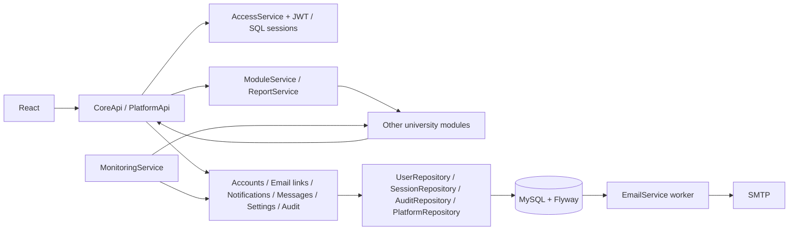

# Backend: requirements, API and implementation

Sources: `../Untitled document (12).pdf`, `../Core_Platform_Admin_Project_Submission.docx`
(requirements, all 21 scenarios, CRC cards, class descriptions and TC1–TC35),
`../class-diagram.drawio.png`, `../use-case-diagram.drawio.png` and the repository README.
The Phase II report incorporates the corrected Phase I requirements. A separate Phase I
SRS file is not present in this repository. The team journal and individual logs describe
the historical prototype scope; they are not evidence that the remaining features were implemented.

## Architecture decision

Keep one Spring Boot application and one MySQL database. Split business responsibilities
into services, matching the CRC cards, without introducing independently deployed services
for every class. A CRC class is a responsibility, not necessarily a Java entity or a network service.



Controllers bind validated requests and translate HTTP responses. Services enforce permission,
ownership and transaction rules. Repositories execute parameterized SQL. `CoreService` retains
existing frontend compatibility; new features have separate services. `AccessService`, `RoleService` and
`SettingsService` implement the Role/Permission responsibilities. Domain records from the
diagram map to SQL tables and explicit JSON projections. Departments currently remain strings;
a managed department catalog and course/group membership need a separately agreed contract.

Account changes, token consumption, notification fan-out and messages commit with their audit
or outbox writes. SMTP and module HTTP calls do not run inside account transactions. SMTP has
its own short, bounded delivery transaction. Audit failure rolls back an administrative write;
login failure counters and their audit events intentionally commit even when login returns 401.

## Why this API is less expensive

- `/me` returns profile, permission codes, enabled module tiles and email preferences in one response.
- `/users` serves administration and directory with different SQL projections and SQL-enforced scope.
  A directory response never contains account status, private profile fields or password hashes.
- User lists have a maximum page size of 100 and stable ordering by name and ID. Matching totals
  are separate SQL counts. Notification, audit and message history use ID cursors.
- Dashboard counters use one aggregate query instead of four counts.
- A conversation list contains at most 50 conversations and the last 20 messages per conversation.
  One window-function query retrieves all selected previews. Older messages have a separate endpoint.
- Notification fan-out uses batch inserts and one preference query rather than a query per recipient.
- SMTP runs through a persistent outbox, with bounded batches, exponential retries and row locks.
- Module reporting has a fixed fan-out of at most four requests and explicit missing data.
  A dedicated executor permits at most eight concurrent upstream report tasks, with no unbounded queue.
- Module health is polled in the background and stored; opening the dashboard does not synchronously
  call all external services.
- V4 adds indexes for directory, unread notifications, message history and queue delivery.

These are structural improvements, not measured latency claims. Substring directory search still
requires scanning candidate rows; at larger volumes, measure queries on MySQL before introducing
full-text/prefix search. A leading `%` cannot use a normal B-tree to seek by name.

## Shared contract

Base path: `/api/v1`. JSON field names use `snake_case`. User requests use
`Authorization: Bearer <JWT>`. Errors from validation/business/security handlers are
`{"detail":"message"}`. Successful bodyless commands return 204.

Codes: 400 invalid/expired/used email link or incorrect current password; 401 missing/invalid
credentials; 403 insufficient permission or inactive account during login; 404 missing resource;
409 duplicate account/conflict; 422 invalid fields; 423 account lockout; 503 disabled,
unconfigured or unavailable module. Gateway responses otherwise preserve the upstream status.

The existing `/admin/users` GET/POST/PATCH routes remain compatible with the current React UI.
`GET /admin/users` retains its capped array response. New clients should use paginated `/users`.
`POST /auth/logout` and `POST /auth/change-password` remain available, although the PDF omits them.

| Method and path | Request / response | Access |
| --- | --- | --- |
| POST `/auth/login` | `{email,password}` → `{access_token,token_type,user}` | Public |
| POST `/auth/logout` | No body → 204; revoke current session | Signed in |
| POST `/auth/register` | `{name,email,password,confirm_password,privacy_accepted:true}` → 201 Pending Applicant | Public |
| POST `/auth/forgot-password` | `{email}` → neutral confirmation | Public, or authorized support with JWT |
| POST `/auth/email-link` | `{token,password?,confirm_password?}` → confirmation session or reset result | Single-use link |
| POST `/auth/module-ticket` | `{code}` → one-use HTTPS launch URL, valid 60 seconds | Signed in, permitted module |
| POST `/auth/module-exchange` | `{ticket}` → module-bound token | Matching server module key |
| POST `/auth/introspect` | `{token}` → active, role, permissions, expiry | Server module key |
| GET `/me` | Profile, `permissions`, enabled `modules`, `email_preferences` | Signed in |
| PATCH `/me` | Preferred name, phone, personal email, HTTPS photo URL, category→boolean `email_preferences`, current/new password | Own account only |
| GET/POST/DELETE `/me/photo` | Private image download, validated PNG/JPEG upload or removal | Own account only |
| POST `/auth/change-password` | `{current_password,new_password,confirm_password}` → 204 | Own account only |
| GET `/users` | `q,role,status,department,page=0,size=50` → `{items,total,page,size}` | `users.view` or scoped `directory.view` |
| POST `/users` | `{name,email,role,department?,console_access?}` → 201 Pending account + invitation | `users.create`; SIS has separate scoped credentials |
| PATCH `/users/{id}` | Official account fields → updated user | `users.edit`; roles/access require Administrator |
| GET `/roles` | Role codes and permission lists | `users.view` or valid module credentials |
| GET `/announcements` | `offset=0,size=50` ? bounded history | Authorized sender; own history or Administrator |
| GET `/notifications` | `before=0,size=50` → `{unread_count,items,has_more,next_before}` | Own inbox |
| POST `/notifications/read` | `{ids:[...]}`; empty list marks all → 204 | Own inbox only |
| POST `/notifications` | `{title,text,category?,user_ids? or audience?,channel?}` → 201 recipient count | Authorized announcement sender or module |
| GET `/conversations` | `before=0,size=20` → cursor page with bounded message previews | Own conversations |
| GET `/conversations/{id}/messages` | `before=0,size=50` → older messages, newest first | Participant only |
| POST `/messages` | `{recipient_id or conversation_id,text}` → 201 message | `messages.send` + allowed recipient |
| GET `/groups` | Visible course/office groups | Signed in |
| PUT `/integrations/groups/{code}` | `{title,group_type,owner_id,member_ids}` → synchronized group | LMS/SIS key or Administrator |
| GET `/admin/dashboard` | Counters, recent activity, `services` | `dashboard.view` |
| GET `/reports` | `period`, optional `format=csv` → scoped rows and missing modules | `reports.view` |
| GET `/admin/settings` | `{settings,modules,roles,permission_codes}` | Administrator |
| PUT `/admin/settings` | Complete `{settings,modules,roles}` → saved snapshot | Administrator + `settings.manage` |
| GET/PUT `/admin/gateway-policies` | Route prefix, method and permission rules | Administrator, edit requires `settings.manage` |
| GET `/admin/audit` | `q,actor,action,result,from,to,before,size,format` → array / CSV | Administrator + `audit.view` |
| GET/POST/PUT/PATCH/DELETE/HEAD `/modules/{code}/**` | Bounded request/response proxy | Active JWT + allowed module; upstream checks business permissions |
| GET `/health/readiness` | Database readiness → 200 or 503 | Public probe |

Settings GET responses can be sent back to PUT; display metadata (`name`, `user_count`,
`permission_codes`) is ignored, and all writable fields are validated atomically.

`before=0` means first page; subsequent calls use `next_before`. User page numbers start at zero.
Audit timestamps `from`/`to` are ISO-8601 instants, for example `2026-11-10T00:00:00Z`.
Audit CSV is capped at 10,000 filtered rows per request; use `before` for older batches.
CSV cells are quoted and spreadsheet formula prefixes neutralized. Report CSV explicitly includes
rows marked `MISSING` for unavailable modules.

Notifications support `audience` values `ALL`, `ROLE:Student`, `DEPARTMENT:Computer Science`,
`COURSE:SDT213`;
`channel` is `in_app` (default), `email` or `both`. A module must supply explicit `user_ids`.
Staff announcements require `announcements.send` and are restricted to their own department.
Faculty course announcements are rejected until course ownership can be verified.

## Security and lifecycle rules

- Effective console role for Staff is Operator or Viewer when assigned; otherwise it is Staff.
  Permissions are loaded from SQL on requests, so revoked permissions apply immediately.
- A Student directory search sees active Faculty/Staff only. Applicants have no general directory
  permission; direct messages are limited to Staff in Admissions. Directory and message rules
  are enforced independently of frontend filtering.
- Operators can create ordinary Pending accounts and edit account details/status when granted
  permissions, but cannot create Administrators or assign console access. Viewer remains read-only.
- Changing role, status or console access revokes target sessions. A user cannot change their own
  console access; the last active Administrator is protected with a serialized database check.
- Settings reject administrative permissions on nonadministrator roles, console permissions on
  portal-only roles and mutation permissions on Viewer. Administrator recovery permissions remain.
- BCrypt validates at most 72 UTF-8 bytes. Configurable minimum length never falls below 8.
- JWT maximum lifetime is 8 hours. SQL sessions enforce the configurable inactivity timeout
  (default 30 minutes); no refresh token is implemented.
- Email tokens contain 256 random bits, are stored as SHA-256 hashes, expire and are single-use.
  Reset/invitation links expire in 24 hours; confirmation links in 7 days. Confirmation creates
  a signed-in session. Password reset/change revokes previous sessions. Reset does not activate
  an inactive account. Expired unconfirmed Applicant accounts are removed by a scheduled task.
- Email bodies in the outbox necessarily contain the delivery link. Restrict DB access and define
  queue retention in deployment. No raw link is returned by the API or written to application logs.
- Public reset responses are neutral, and repeated requests for one account are coalesced for
  60 seconds. Production registration/login/reset endpoints still need ingress rate limits.
- SMTP is at-least-once delivery: a process failure after the server accepted a message but before
  DB commit can cause a duplicate email. Token consumption remains single-use.
- Audit has no API update/delete routes. DB-level immutability, a one-year retention policy,
  HTTPS, backups, availability and performance targets remain deployment/operations work.

## Integration configuration and boundary

Use separate random `SIS_MODULE_KEY`, `LMS_MODULE_KEY`, `SCHEDULING_MODULE_KEY`,
`ADMISSIONS_MODULE_KEY`. Empty keys authorize nobody. Keys belong only on trusted servers,
not in browser JavaScript. `X-Module-Key` is accepted only by documented server integration routes.
Only SIS can synchronize Student accounts. Existing Applicant passwords
and confirmation requirements are preserved; repeating a Student sync does not create duplicates.

Set `SIS_MODULE_URL`, `LMS_MODULE_URL`, `SCHEDULING_MODULE_URL`, `ADMISSIONS_MODULE_URL`
to trusted internal base URLs. Administrators can toggle modules but cannot supply arbitrary URLs.
The proxy forwards the bearer token and content type, without cookies or module keys. Redirects
are not followed; traversal/encoded paths are rejected. A streaming servlet filter caps API request payloads at 1 MB, including chunked requests;
upstream response subscribers cancel at 2 MB. A three-second deadline covers the entire upstream
response, including body delivery. Ingress limits can reject oversized traffic earlier.
Responses are sandboxed to prevent upstream HTML executing on the platform origin.

Proposed adapter contracts, requiring agreement and end-to-end tests with the other teams:

```http
GET <module-base>/health
# 2xx = healthy; a slow response becomes Degraded; no response/non-2xx becomes Down.

GET <module-base>/reports?period=Fall+2026
Authorization: Bearer ...
# For Faculty: LMS only, plus faculty_id=<authenticated core user id>.
# Module must validate token and independently enforce ownership.
```

```json
{"rows":[{"metric":"enrolled_students","value":1200}]}
```

Additional local contracts:

```http
PUT /api/v1/integrations/groups/{code}
X-Module-Key: <LMS or SIS key>
Content-Type: application/json
{"title":"SDT 213","group_type":"COURSE","owner_id":42,"member_ids":[43,44]}

POST /api/v1/auth/module-ticket
Authorization: Bearer <core session>
{"code":"lms"}
# Returns a 60-second, one-use ticket in an HTTPS launch URL.

POST /api/v1/auth/module-exchange
X-Module-Key: <LMS key>
{"ticket":"..."}
# Returns a module-bound bearer token, tied to the core session.

POST /api/v1/auth/introspect
X-Module-Key: <LMS key>
{"token":"..."}
# Returns active, role and current permissions; revocation is checked on every call.
```

The gateway applies configured route policies by method and longest matching path prefix.
The module must call introspection, enforce the returned permissions and validate ownership of
specific courses/records. The shared-secret contract requires agreement, provisioning and
end-to-end tests with independently deployed modules. These contracts do not prove that other
teams already implement them.

## Traceability and remaining work

| Use case / FR | Backend implementation | Remaining scope |
| --- | --- | --- |
| UC1 / FR1,2,5,7 | AuthService, SessionValidator, AccessService, module ticket exchange/introspection, gateway | External module token validation and resource authorization |
| UC2–UC4 / FR3,4,6 | EmailLinkService, PasswordPolicy, AuthService, outbox | Frontend registration/reset/link screens; SMTP deployment |
| UC5 / FR8 | Aggregated counters, monthly growth, recent audit and stored module health | Operational load measurement |
| UC6–UC8 / FR9–16 | Paginated accounts, invitation, support reset, scoped SIS sync | Agreed external SIS record contract and concurrency integration test |
| UC9–UC10 / FR17,18 | Self profile, validated private photo storage, SQL directory scope | Department catalog from university source |
| UC11 / FR19–21 | RoleService / SettingsService permissions, protected role assignment | Dedicated UI editor |
| UC12–UC13 / FR22–24 | Shared notification inbox/read/preferences and SMTP outbox | UI connection, cross-team credential provisioning |
| UC14 / FR25 | Role/department/global and verified course audiences, announcement persistence | Announcement-history UI and LMS group synchronization |
| UC15 / FR26 | Private, office and course conversations with live membership checks and cursor history | External course/office roster synchronization |
| UC16 / FR27,28 | Report fan-out, missing-data handling, CSV | Real module adapters and course ownership tests |
| UC17 / FR29,30 | Validated atomic settings/permissions/module switches | UI; SMTP host/secret changes remain environment configuration |
| UC18 / FR31,32 | Scheduled health snapshots, internal subsystem probes and transition alerts | Deployment-level uptime measurements |
| UC19–UC20 / FR33–35 | Search/date/result filters, escaped CSV, durable ordered audit queue and MySQL immutability triggers | Retention/archive policy in operations |
| UC21 / FR36,37 | Configurable bounded proxy, editable route policies and integration APIs | Real upstream permission/ownership enforcement |

The local REST workflows are implemented, but their external integrations and operational NFRs
require a deployment environment and the other teams' services. The current React screens still
expose the earlier subset. The Phase II
Word report and diagrams are retained as the original requirements/design baseline.

Automated coverage is in `ApiTest`, `PlatformApiTest`, `AuditDispatcherTest`, `ModuleServiceTest` and `RequestSizeFilterTest`: authentication/access, lockout, account
editing, registration/confirmation/expiry, reset/session revocation, profile/directory privacy,
invitation/SIS boundaries, notification ownership/preferences, message membership, settings
validation/module disabling, live permission revocation, inactivity timeout, audit CSV and missing report data,
SMTP retry, transition-only health alerts, course membership revocation, office message isolation,
module-ticket one-use exchange and revocation, gateway policy matching, photo validation, durable
audit dispatch, actual local HTTP forwarding, response-size cancellation,
streaming request limits and generated OpenAPI security schemes.
Run `mvn test` on JDK 17+; H2 tests do not replace a MySQL 8.4 migration/concurrency test or
end-to-end tests against real SMTP and university modules. CI runs the suite on H2 and MySQL 8.4;
the MySQL job also applies the vendor-specific immutable-audit migration.

## Deployment checks

For production, set `APP_ENV=production`, disable demo seeding, provide a private `JWT_SECRET`,
database credentials, distinct module keys, internal module URLs, HTTPS module web URLs, and SMTP.
Expose the application only through a TLS ingress. The public `/api/v1/health/readiness` checks
database connectivity; the administrator dashboard shows worker and external-module states.
Schedule encrypted MySQL backups outside the application, retain them for the institution's
required period, and test a restore into an isolated database. Restrict direct database writes to
the application and migration roles; V7 blocks ordinary UPDATE/DELETE of audit entries in MySQL.
Measure latency, concurrent users, uptime and recovery against the actual NFR targets in the
deployment environment. Local tests cannot establish those operational properties.
